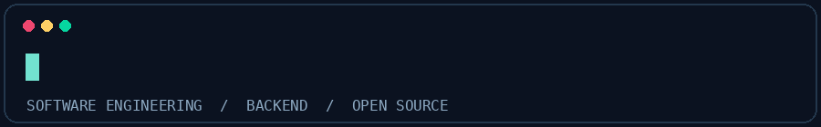

<div align="center">



# Zain Viamonte

**Software Engineering Student | Backend & Full Stack Developer | Open Source Builder**

Building reliable APIs, business applications, developer tooling and real-time systems.

[](https://github.com/yukio-kayaba)
[](https://www.npmjs.com/package/zormz)
[](#about-me)

</div>

---

##  About me

```text
zain@github
---------------------------------------------------------
Focus       Backend engineering, architecture and APIs
Building    Multi-tenant business systems and developer tools
Exploring   Real-time systems, networking, AI and desktop apps
Environment Linux / Windows
Principle   Build practical tools, keep systems maintainable
```

I'm a Systems and Computer Engineering student at the **National Amazonian University of Madre de Dios (UNAMAD), Peru**. I enjoy designing typed APIs, relational data models and applications that solve practical problems. I also develop desktop interfaces with **Qt / QML / C++**, experiment with Linux and networking, and build my own developer tooling.

## Technology stack

<div align="center">

### Languages


### Backend and real-time


### Interfaces and applications


### Infrastructure and developer workflow


<a href="https://apidog.com/"></a>
<a href="https://socket.io/"></a>
<a href="https://zod.dev/"></a>

</div>

## Selected projects

| Project | What I build | Stack |
|:---|:---|:---|
| **[ZORMZ](https://www.npmjs.com/package/zormz)** | My own TypeScript ORM/query builder for PostgreSQL and MySQL, with typed queries and multiple database connections. | TypeScript, SQL, Node.js |
| **Multi-tenant inventory platform** | Inventory, serial-numbered devices, sales, cash sessions, store management and permissions. | Node.js, Express, PostgreSQL, Socket.IO |
| **School management platform** | Attendance, grades, family notifications and QR-based student access. | TypeScript, Qt/QML, SQL |
| **Ticketing and payments** | Seat reservation lifecycle, order handling and payment integration. | TypeScript, SQL, Mercado Pago |

> Some projects are under active development. Project descriptions are not claims that every feature is publicly released.

## GitHub activity

<div align="center">
  
</div>

## How I work

- **API engineering:** TypeScript, Express, Zod, JWT, REST and Apidog for API design/testing.
- **Data:** relational schemas, PostgreSQL/MySQL, query optimization and transaction-aware business flows.
- **Applications:** Qt/QML desktop development and mobile application integration.
- **Infrastructure:** Linux, Git, virtualization, networking and deployment experiments.

<div align="center">

---

**Build. Test. Improve. Repeat.**

<sub>Animated terminal and activity indicator are included locally in <code>assets/</code>. Technology logos are loaded from Skill Icons.</sub>

</div>
